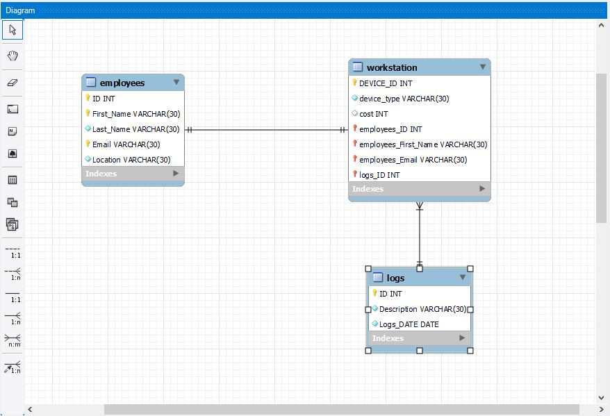
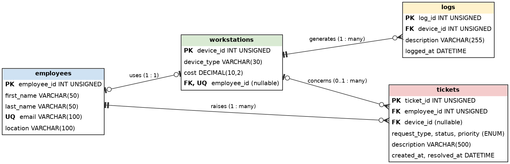

# Lab: Designing a Relational Database, Reviewing My First ERD, and Writing the SQL

**Goal:** turn a short client brief into a relational design (an entity-relationship diagram and a rerunnable SQL script), then review my own first draft, fix its mistakes, and record the lessons.

**Who this is for:** beginners to database design. **Time:** about 90 minutes. Files: [`it_asset_tracker.sql`](../sql/it_asset_tracker.sql) and [`cookie_bakery.sql`](../sql/cookie_bakery.sql).

## Quick checklist
- [ ] Read the brief and list entities and relationships
- [ ] Review my first ERD draft and note its mistakes
- [ ] Draw the corrected ERD
- [ ] Write and run the rerunnable SQL script
- [ ] Test the one-to-one and duplicate rules
- [ ] Screenshots D1 to D3

## The brief
A company's IT team needs a database. It must track **employees** (ID, first name, last name, email, location), **workstations** (device ID, device type, cost) and **logs** (ID, description, and a timestamp with month, day, year and hours). **One employee has one workstation** and **one workstation has many logs**. The client also wants to track **ticket requests** from employees about workstations but did not say how, so the designer decides.

## 1. My first ERD draft

It captured the three tables and the two relationships, which is a decent start. Reviewing it, I found these problems:

| Problem in my draft | Why it is a problem | Fix |
|---|---|---|
| `logs_ID` stored in `workstation` | That makes each workstation point at one log. A workstation has *many* logs, so the link must run the other way | Put `device_id` as a foreign key in `logs` |
| `employees_First_Name` and `employees_Email` copied into `workstation` | Duplicated data can drift out of sync | Keep only `employee_id`; look up names with a join |
| Several `employees` columns marked as keys (ID, First_Name, Email) | A table has one primary key; extra keys should be `UNIQUE` constraints only where needed | `PRIMARY KEY (employee_id)` and `UNIQUE (email)` |
| `Logs_DATE` as `DATE` | A date has no hours, but the brief asked for hours | Use `DATETIME` |
| `cost` as `INT` | Money has cents | `DECIMAL(10,2)` |
| No ticket table | The client asked for it | Add `tickets` |
| One-to-one not enforced | The diagram line alone does not stop two workstations sharing an employee | `UNIQUE` on `workstations.employee_id` |

## 2. The corrected design

**Reading the crow's-foot symbols:** a single bar means *one*; a circle means *zero*; the three-pronged "crow's foot" means *many*. So `bar + circle` is "zero or one" and `circle + crow's foot` is "zero or many".

| Relationship | Meaning | How it is built |
|---|---|---|
| employees to workstations | One employee uses one workstation | `workstations.employee_id`, a `UNIQUE` foreign key that can be NULL for spare devices |
| workstations to logs | One workstation has many logs | `logs.device_id`, a foreign key on the "many" side |
| employees to tickets | One employee raises many tickets | `tickets.employee_id`, required |
| workstations to tickets | A ticket may concern one workstation | `tickets.device_id`, optional |

**Ticket design decision:** a ticket belongs to the employee who raised it, may point at one workstation, and carries a request type, status and priority (`ENUM`s), a description, and created and resolved timestamps. This answers the open request without guessing more than the brief allows.

## 3. The SQL script
The full script is in [`sql/it_asset_tracker.sql`](../sql/it_asset_tracker.sql). The practices it demonstrates:
- **Rerunnable:** `CREATE DATABASE IF NOT EXISTS` and `CREATE TABLE IF NOT EXISTS`, so a second run does no harm.
- **`USE` after creating the database**, so tables land in the right place.
- **Auto-incrementing primary keys:** `INT UNSIGNED NOT NULL AUTO_INCREMENT`.
- **Foreign keys with explicit rules:** `ON DELETE CASCADE`, `SET NULL` or `RESTRICT`, chosen on purpose.
- **Constraints:** `NOT NULL`, `UNIQUE`, `CHECK (cost >= 0)`.
- **Indexes** on the columns used to look things up.
- **Duplicate-safe inserts:** `INSERT IGNORE` (skips rows that would break a `UNIQUE` rule); `ON DUPLICATE KEY UPDATE` is the alternative when you want to update instead.
- **Comments** explaining decisions, so the next developer can follow them.

## 4. Reviewing my earlier script
I wrote a small bakery database as an earlier exercise. Its first version had mistakes that I now recognize:

| In the first version | Problem | In the corrected script |
|---|---|---|
| Created `cookie_size`, then inserted into `cake_size` | The second table does not exist, so the insert fails | One consistent table name (`sizes`) |
| No `USE` after `CREATE DATABASE` | Tables could be created in the wrong database | `USE cookie_bakery;` |
| `INT(10)` and `price INT(30)` | The display width is deprecated in MySQL 8, and a price should not be an integer with width 30 | `DECIMAL(6,2)` for price, plain `INT UNSIGNED` for keys |
| A foreign key on an `AUTO_INCREMENT` column pointing at the size table | A column cannot sensibly be both a generated ID and a reference to another table | Separate `flavour_id` primary key and a real `orders` table with its own foreign keys |
| Composite primary key `(phone, first_name)` | Changing a name or number would change the key | Surrogate `customer_id`, with `UNIQUE (phone)` |
| `f_ingredients` as a `PRIMARY KEY` | A text field is a poor key | `UNIQUE` name instead |
| Author name and personal details in the file header | Not needed in a shared file | Short, neutral header |

## 5. Try it
- [ ] Install MySQL (see the [Workbench lab](mysql-workbench-setup-and-sakila-queries.md)).
- [ ] Open `it_asset_tracker.sql` in Workbench and run it. Run it again to prove it is safe to repeat.
- [ ] In Workbench use **Database, Reverse Engineer** to produce an ER diagram from the live database and compare it with mine.
- [ ] Insert a row twice with `INSERT IGNORE` and note that the second does nothing.
- [ ] Try inserting two workstations for one employee and read the error: that is the one-to-one rule working.
- 📸 **D1** `d01-script-run-ok.png`
- 📸 **D2** `d02-reverse-engineered-erd.png`
- 📸 **D3** `d03-unique-violation-error.png`

## 6. Screenshot shot list

| ID | File | Shows | Redact |
|---|---|---|---|
| D0 | `draft-it-asset-erd.png` | My first draft (done) | Nothing |
| D1 | `d01-script-run-ok.png` | Script runs without errors | Nothing |
| D2 | `d02-reverse-engineered-erd.png` | Workbench diagram | Nothing |
| D3 | `d03-unique-violation-error.png` | One-to-one rule enforced | Nothing |

## 7. Concepts to explain
- **Entity, attribute, relationship; primary and foreign key.**
- **Cardinality** (one-to-one, one-to-many, many-to-many) and **optionality** (zero or one vs exactly one).
- **Normalization:** avoid storing the same fact twice.
- **Referential integrity:** a foreign key cannot point at a row that does not exist.
- **Idempotent scripts:** safe to run repeatedly.

## 8. Security connection (for the short answers)
- **Data minimization:** store only what you need (the design keeps contact details in one table).
- **Integrity constraints are security controls:** they stop bad or inconsistent data from entering.
- **Auditability:** the `logs` and `tickets` tables, with timestamps, support accountability and investigation.
- **Separate accounts for people and applications**, with privileges limited to the tables each needs (see the [users and backup lab](mysql-users-privileges-backup-restore.md)).

## 9. Troubleshooting

| Symptom | Likely cause | Fix |
|---|---|---|
| Error 1215 "cannot add foreign key constraint" | Column types differ, or the referenced table does not exist yet | Match types exactly (`INT UNSIGNED` to `INT UNSIGNED`) and create parents first |
| `CHECK` seems ignored | MySQL older than 8.0.16 | Upgrade; older versions parse but do not enforce it |
| Duplicate entry error on rerun | Data inserted without `INSERT IGNORE` | Use `INSERT IGNORE` or `ON DUPLICATE KEY UPDATE` |
| Tables created in the wrong database | Missing `USE` | Add `USE it_asset_tracker;` |

## 10. My results
- **What I designed:** *(entities, relationships, decisions)*
- **What I changed after review:** *(table in section 1)*
- **Problems I hit and how I fixed them:**
- **What I want to learn next:** *(normal forms, indexing strategy, or stored procedures)*

## Sources and notes
Design reasoning is my own. Syntax follows the MySQL documentation: [CREATE TABLE](https://dev.mysql.com/doc/refman/8.0/en/create-table.html), [FOREIGN KEY constraints](https://dev.mysql.com/doc/refman/8.0/en/create-table-foreign-keys.html) and [CHECK constraints](https://dev.mysql.com/doc/refman/8.0/en/create-table-check-constraints.html). Run the script in Workbench and correct anything your MySQL version reports.
