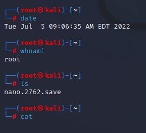
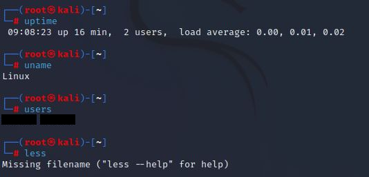
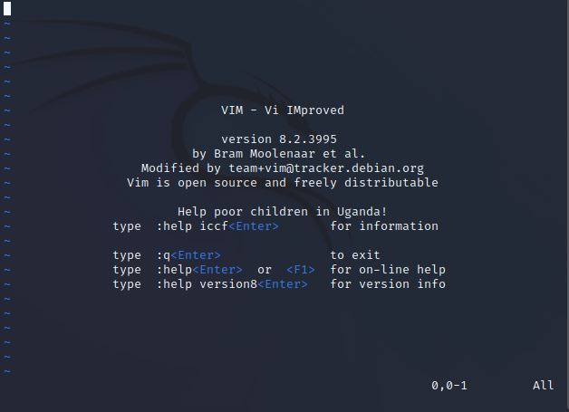
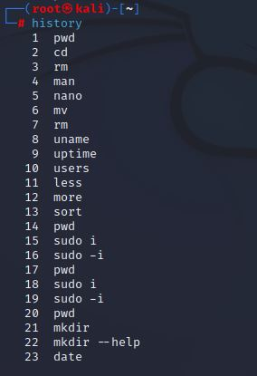

# Lab: Linux Command-Line Basics on Kali

**Goal:** get comfortable in the Linux terminal: move around, manage files, read system information, edit text, find help, and review what you ran. These are the day-to-day skills behind every security tool on Kali.

**Who this is for:** beginners with a Kali VM (see the [Kali setup](../../intro-to-cybersecurity/labs/02-wireshark-and-virtualbox.md)). **Time:** about 45 minutes.

> **Safety:** work in a VM you can reset. `rm` deletes permanently, with no recycle bin. Practice destructive commands only on throwaway files you created.

## Quick checklist
- [ ] Open a terminal and note the prompt
- [ ] Practice navigation: `pwd`, `ls`, `cd`
- [ ] Create, move and remove files and folders
- [ ] Read system info: `uname`, `uptime`, `users`, `whoami`, `date`
- [ ] Read files: `cat`, `less`, `more`, `sort`
- [ ] Edit with `nano`, then open and quit `vim`
- [ ] Use `man` and `--help`
- [ ] Review `history`

## 1. Reading the prompt
`(root㉿kali)-[~]` followed by `#` means: logged in as **root**, on a machine named **kali**, in the home directory `~`. A `#` ends the prompt for root; a normal user's prompt ends in `$`. Running everything as root is convenient and risky; see section 8.

## 2. Command reference
| Command | What it does | Example |
|---|---|---|
| `pwd` | Print the folder you are in | `pwd` |
| `ls` | List files (`-l` long, `-a` hidden) | `ls -la` |
| `cd` | Change folder (`cd ..` up, `cd ~` home) | `cd /etc` |
| `mkdir` | Make a folder (`-p` for nested) | `mkdir lab1` |
| `mv` | Move or rename | `mv a.txt lab1/` |
| `rm` | Remove files (`-r` for folders, careful) | `rm old.txt` |
| `cat` | Print a file (with no argument it waits for typed input; press Ctrl+D) | `cat notes.txt` |
| `less` / `more` | Page through a file (`q` quits `less`) | `less /etc/passwd` |
| `sort` | Sort lines | `sort names.txt` |
| `uname` | Kernel info (`-a` for everything) | `uname -a` |
| `uptime` | How long the system has been up, users logged in, load average | `uptime` |
| `users` | Names of users currently logged in | `users` |
| `whoami` | The account you are using | `whoami` |
| `date` | Current date and time | `date` |
| `man` | Open a command's manual | `man ls` |
| `nano` | Beginner-friendly editor (Ctrl+O save, Ctrl+X exit) | `nano notes.txt` |
| `vim` | Powerful editor (`:q` quit, `:wq` save and quit) | `vim notes.txt` |
| `history` | List your previous commands | `history` |
| `sudo` | Run one command with admin rights (`sudo -i` opens a root shell) | `sudo apt update` |

## 3. My practice session
### System information

`date` showed the clock, `whoami` returned `root`, and `ls` listed one file, `nano.2762.save`. Nano creates a file named like that when it is interrupted, as an emergency copy of what you were editing.


`uptime` reported 16 minutes up, 2 users, load averages near 0. `uname` printed `Linux`. `users` listed the logged-in accounts (blacked out here). `less` with no file complained about a missing filename, which is its way of telling you it needs something to read.

### Editors and history

`vim` starts in **normal mode**: typing letters runs commands, not text. Press `i` to insert text, `Esc` to return, and `:q` or `:wq` to leave. Forgetting how to exit is the classic beginner trap.


`history` numbers every command from this session. In it, `sudo i` appears several times before `sudo -i`: the first form is wrong, because the option needs the dash. A numbered history like this is also an audit trail, and a risk.

## 4. Exercises (do these and note what you see)
1. In your home folder run `mkdir lab1`, `cd lab1`, `nano notes.txt`, type three lines, save and exit.
2. `cat notes.txt`, then `sort notes.txt`, then `less notes.txt`.
3. `mv notes.txt renamed.txt`, `ls`, then `rm renamed.txt` and `ls` again.
4. `man ls`, find the flag that sorts by size, and use it.
5. `history | tail -5` to see your last five commands.

## 5. Pipes and redirection (one step further)
`|` sends one command's output into another; `>` writes output to a file.
```bash
ls -la | less            # scroll a long listing
history | grep sudo      # find every sudo you ran
uname -a > sysinfo.txt   # save output to a file
```

## 6. Screenshot shot list and redaction

| ID | File | Shows | Redact |
|---|---|---|---|
| L1 | `01-date-whoami-ls.png` | date, whoami, ls | Done |
| L2 | `02-uptime-uname-users-less.png` | System info | Account names (done) |
| L3 | `03-vim-start-screen.png` | Vim | Nothing |
| L4 | `04-command-history.png` | history | Anything sensitive typed in commands (none here) |

## 7. Concepts to explain
- **Shell and terminal:** the terminal is the window; the shell (Bash by default on Kali) interprets your commands.
- **Everything is a file** in Linux, including devices; commands combine small tools.
- **Flags** change a command's behavior (`ls -l`). `--help` or `man` lists them.
- **Root** is the all-powerful account; `sudo` grants it temporarily and is logged.

## 8. Security connection (for the short answers)
- **Least privilege:** use a normal account and `sudo` for single admin tasks. A mistyped command as root can destroy the system, and malware run as root controls everything.
- **History is evidence and exposure:** `history` shows what was run, which is useful for investigations, but passwords typed on the command line are stored in plain text in `~/.bash_history`. Never put secrets in a command line.
- **Auditing users:** `users`, `who` and `last` show who is or was logged in, a first check when you suspect unauthorized access.
- **Dangerous habits:** `rm -r` without checking the path, and running scripts from the internet as root.

## 9. Troubleshooting

| Symptom | Likely cause | Fix |
|---|---|---|
| `command not found` | Typo, or tool not installed | Check spelling; `sudo apt install <name>` |
| `Permission denied` | Not allowed to read or write there | Check with `ls -l`; use `sudo` only if you really need to |
| Stuck in `vim` | Normal mode | Press `Esc`, then type `:q!` and Enter to quit without saving |
| Stuck in `less` or `man` | Pager open | Press `q` |
| `cat` seems frozen | Waiting for input | Press Ctrl+D (or Ctrl+C to cancel) |

## 10. My results
- **What I ran and what I saw:** *(from L1 to L4)*
- **Problems I hit and how I fixed them:**
- **What I want to learn next:** *(for example file permissions with `chmod` and `chown`, `grep`, `find`, or shell scripting)*

## Sources and notes
Commands are standard GNU/Linux tools; see each tool's `man` page. Screenshots are from my own Kali VM.
