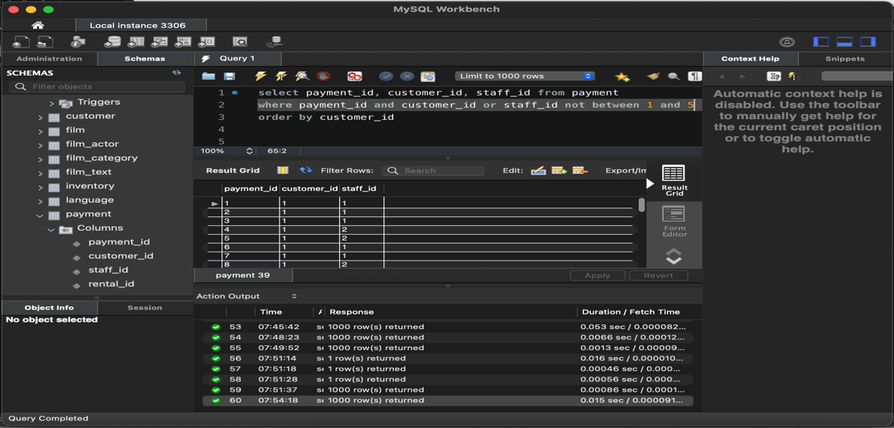

# Lab: MySQL Workbench Setup and SQL Practice on the Sakila Database

**Goal:** install MySQL and Workbench, open the Sakila sample database, and use the core `SELECT` clauses with confidence.

**Who this is for:** beginners to databases. **Time:** about 75 minutes. All queries are in [`sakila_practice.sql`](../sql/sakila_practice.sql).

> **Safety:** keep the server on `localhost`, use a strong root password you do not reuse elsewhere, and do not expose port 3306 to a network.

## Quick checklist
- [ ] Install MySQL Community Server and Workbench
- [ ] Set a strong root password
- [ ] Open Workbench and connect to `Local instance`
- [ ] Find the `sakila` schema and run a first query
- [ ] Practice each clause (section 3)
- [ ] Screenshots M1 to M4

## 1. Install
- Download MySQL Community Edition from [dev.mysql.com/downloads](https://dev.mysql.com/downloads/). Choose a setup type that includes **MySQL Server, MySQL Workbench and the sample databases** (the *Developer Default* option on Windows does).
- Set a **strong root password** during setup. The default or an easy password is the first thing an attacker tries.
- If your computer cannot run Workbench, a browser-based MySQL practice editor can stand in, but you will not be able to practice installation or user accounts there.
- The Sakila schema is documented at [dev.mysql.com/doc/sakila](https://dev.mysql.com/doc/sakila/en/): a DVD-rental business with actors, films, inventory, customers, rentals and payments.

## 2. First query
In Workbench, open the connection, then in a query tab run:
```sql
USE sakila;
SELECT * FROM actor;
```
The result grid shows the rows; the **Action Output** panel below shows how many were returned and how long it took (200 rows for `actor`).

## 3. The clauses, with one example each
| Clause | Purpose | Example |
|---|---|---|
| `SELECT` | Choose columns | `SELECT first_name, last_name FROM actor;` |
| `ORDER BY` | Sort | `SELECT title, rental_rate FROM film ORDER BY rental_rate DESC, title;` |
| `WHERE` | Filter rows | `SELECT title FROM film WHERE length > 180;` |
| `DISTINCT` | Remove duplicates | `SELECT DISTINCT rating FROM film;` |
| `AND` | Both true | `... WHERE rating = 'PG' AND length < 90;` |
| `OR` with `AND` | Either, grouped | `... WHERE (rating='G' OR rating='PG') AND rental_rate = 0.99;` |
| `IN` | Match a list or subquery | `... WHERE rating IN ('G','PG');` |
| `BETWEEN` | Inclusive range | `... WHERE length BETWEEN 60 AND 90;` |
| `LIKE` | Pattern (`%` many, `_` one) | `... WHERE title LIKE 'ACADEMY%';` |
| `LIMIT` | Cap the rows | `... ORDER BY length DESC LIMIT 10;` |
| `IS NULL` | Test for missing values | `... WHERE return_date IS NULL;` |

**Tip:** `= NULL` never matches anything. Missing values must be tested with `IS NULL` or `IS NOT NULL`.

## 4. My first attempt, and the fix

*My early `BETWEEN` query in Workbench. The Action Output shows each run and the rows returned.*

The condition I wrote was:
```sql
WHERE payment_id AND customer_id OR staff_id NOT BETWEEN 1 AND 5
```
It runs, but it does not mean what I intended. `payment_id AND customer_id` treats two numbers as true/false values, and `NOT BETWEEN` only applies to `staff_id`. Each column needs its own comparison. A clearer query is:
```sql
SELECT payment_id, customer_id, staff_id
FROM payment
WHERE payment_id NOT BETWEEN 1 AND 5
ORDER BY customer_id;
```
**Lesson:** a query that returns rows is not necessarily a correct query. Check the logic, not just the output.

## 5. Practice questions
The corrected solutions to these are in the SQL file.
- Which actors have the first name `SCARLETT`? How many distinct last names are there?
- Which last names appear exactly once? More than once?
- Which actor appears in the most films?
- Is a film available at store 1? (Think: which copies are *not* currently rented?)
- When is a rental due? (Rental date plus the film's rental duration.)
- What is the average film length, by category, and which categories are longer than average?
- **Why does `SELECT * FROM film NATURAL JOIN inventory;` return nothing?** `NATURAL JOIN` matches on *every* column the two tables share. Both tables have `film_id` and also `last_update`, so rows only match if their `last_update` timestamps are identical too, which almost never happens. Use an explicit `JOIN ... ON film.film_id = inventory.film_id` instead.

## 6. Screenshot shot list

| ID | File | Shows | Redact |
|---|---|---|---|
| M1 | `01-workbench-between-query.png` | Query and results (done) | Window cropped to remove other apps |
| M2 | `02-sakila-first-query.png` | `SELECT * FROM actor` | Nothing |
| M3 | `03-where-and-order.png` | Filter and sort | Nothing |
| M4 | `04-like-limit-isnull.png` | Pattern, limit, null test | Nothing |

Do not show your root password, and turn off "Save password in vault" if you do not want it stored.

## 7. Concepts to explain
- **Database vs DBMS:** the data vs the software (MySQL) that stores and serves it.
- **Schema:** the structure of tables and relationships.
- **Order of evaluation:** `FROM`, `WHERE`, `GROUP BY`, `HAVING`, `SELECT`, `ORDER BY`, `LIMIT`.
- **Joins** combine tables on related columns; `ON` states which columns.
- **Aggregate functions** (`COUNT`, `AVG`) summarize groups; `HAVING` filters groups, `WHERE` filters rows.

## 8. Security connection (for the short answers)
- **SQL injection** happens when user input is pasted into a query string. The defense is **parameterized queries**, not clever filtering.
- **Least privilege:** applications should connect with an account that can do only what they need, never `root`.
- **Default and weak credentials** are how many database compromises begin; see [database security](../notes/database-security.md).

## 9. Troubleshooting

| Symptom | Likely cause | Fix |
|---|---|---|
| Cannot connect | Server not running, wrong password, or wrong port | Start the MySQL service; check the connection settings (default port 3306) |
| `sakila` missing | Sample databases were not installed | Re-run the installer and add *Samples and Examples*, or import from dev.mysql.com |
| Query returns zero rows | Case, spelling, or wrong condition | Sakila stores names in capitals; check with `LIKE` |
| Error 1064 | Syntax error | Check commas, quotes and semicolons |
| Wrong results | Logic error | Test conditions one at a time (see section 4) |

## 10. My results
- **What I installed and ran:** *(version and clauses practiced)*
- **Problems I hit and how I fixed them:**
- **What I want to learn next:** *(joins, subqueries, indexes, or `EXPLAIN`)*

## Sources and notes
Sakila: [MySQL documentation](https://dev.mysql.com/doc/sakila/en/). Practice questions are adapted from the public practice set at datamastery.gitlab.io; all queries here are my own, corrected versions.
