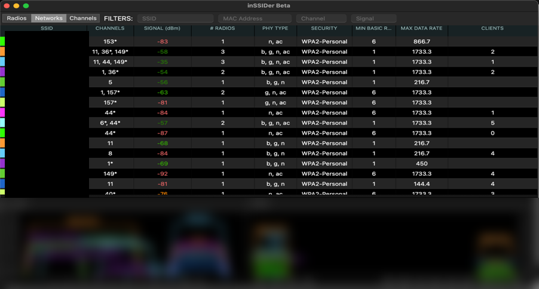
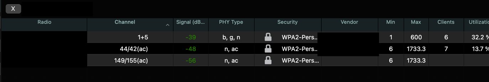

# Lab: Assessing Your Own Wi-Fi with a Scanner (inSSIDer)

**Goal:** measure your home Wi-Fi's signal and channels, identify its security level, spot weaknesses, and decide on fixes, using only your own network.

**Who this is for:** beginners. **Time:** about 45 minutes.

> **Authorization:** assess **only your own network**. A scanner like this is passive (it listens to what access points broadcast), but pointing tools at networks you do not own can cross legal and ethical lines. Neighbors' network names are personal information: do not publish them.

## Quick checklist
- [ ] Install a Wi-Fi scanner (inSSIDer or an alternative)
- [ ] Walk test: record signal strength at several spots
- [ ] Read the network dashboard: channels, bands, security
- [ ] Look at your own router's detail view
- [ ] Note weaknesses and write the fixes
- [ ] Screenshots W1 to W5, hiding every network name and MAC address

## 1. The tool and its alternatives
**inSSIDer** (MetaGeek) shows nearby networks, their channels and signal strength. Availability has changed over the years: the current free tier needs a MetaGeek account and the vendor's support pages have moved, so check the current download page before relying on it. If it is not available, these do the same job:
| Platform | Option |
|---|---|
| Windows | `netsh wlan show networks mode=bssid` (built in) |
| Linux (including Kali) | `nmcli device wifi list` (built in) |
| macOS | Wireless Diagnostics (hold Option and click the Wi-Fi icon) |
| Android | A Wi-Fi analyzer app |
| Cross-platform | NetSpot (free tier) |

## 2. The walk test (signal strength)
Signal is measured in **dBm**, a negative number: closer to 0 is stronger.

| Signal | Rough meaning |
|---|---|
| −30 to −50 dBm | Excellent |
| −50 to −60 dBm | Good |
| −60 to −70 dBm | Fair (video calls may struggle) |
| Below −70 dBm | Weak |

- [ ] Stand next to the router and record your network's signal
- [ ] Walk to each room and record it again, noting the room
- [ ] Note which walls, floors or appliances cause the biggest drops

| Location | 2.4 GHz (dBm) | 5 GHz (dBm) | Notes |
|---|---|---|---|
| Next to router | | | |
| Living room | | | |
| Bedroom | | | |
| Far corner | | | |

## 3. Read the dashboard

*A scan of nearby networks. All network names are hidden and the spectrum graphs blurred, because they identify neighbors.*

What the columns mean:
| Column | Meaning |
|---|---|
| Channels | Which channel(s) the network uses. An asterisk marks bonded or extended channels |
| Signal | Strength in dBm |
| # Radios | How many radios (bands/BSSIDs) the network broadcasts from |
| PHY type | The standards in use: b/g/n (2.4 GHz era) and n/ac (5 GHz) |
| Security | The encryption mode, such as WPA2-Personal |
| Min basic rate / Max data rate | Lowest rate the network requires / highest it supports |
| Clients | Devices connected (when visible) |

**Observations from my scan:**
- **Crowding on 2.4 GHz:** many networks share a few channels (1, 6, 11 are the non-overlapping ones). Overlap causes interference and slower speeds.
- **5 GHz is less crowded** and offers wider channels and higher rates, but has shorter range through walls.
- **Every nearby network used WPA2-Personal.** None were open or on obsolete WEP. None showed WPA3.
- **No scanner can see passwords or private traffic;** it only reads what access points announce.

## 4. My own router

*The detail view for my network. The network name, each radio's MAC address (BSSID) and the vendor name are hidden.*

| Radio | Channel | Signal | PHY | Security | Notes |
|---|---|---|---|---|---|
| 2.4 GHz | 1 + 5 (40 MHz wide) | −39 dBm | b, g, n | WPA2-Personal | 6 clients, 32.2% utilization |
| 5 GHz | 44/42 (ac, 80 MHz) | −48 dBm | n, ac | WPA2-Personal | 7 clients, 13.7% utilization |
| 5 GHz (second) | 149/155 (ac) | −56 dBm | n, ac | WPA2-Personal | |

**Findings:**
- **Configuration:** a dual-band router with separate 2.4 GHz and 5 GHz radios; the vendor column (hidden here) identified a router brand typical of ISP-supplied equipment. The 2.4 GHz radio uses 40 MHz channel bonding, which gives more speed but takes more of a crowded band and overlaps more neighbors.
- **Security level:** WPA2-Personal (a pre-shared passphrase). Good, not the newest.
- **Vulnerabilities this view hints at (not proof of a problem):** WPA2-Personal security depends entirely on a strong passphrase; ISP routers often ship with WPS enabled and a default admin password that was never changed; firmware may be outdated.
- **Recommended fixes:**
  1. Use **WPA3-Personal** (or WPA2/WPA3 transition mode) if router and devices support it.
  2. Set a **long, unique passphrase** (a 4-word or longer passphrase beats a short complex one).
  3. **Disable WPS.**
  4. Change the router's **admin password** and turn off remote administration.
  5. **Update the firmware.**
  6. Put smart-home gadgets and guests on a **guest network**.
  7. Use a **20 MHz channel on 2.4 GHz** on a non-overlapping channel if interference is a problem.

## 5. Other scanners and a note on exporting data
Other network scanners include NetSpot, Acrylic Wi-Fi, Wireshark (with a monitor-mode adapter), Kismet, and wired-network scanners like Nmap (covered in the [scanners note](../notes/network-scanners-and-protocol-analyzers.md)). Some scanners can export their results; if you open an export in Wireshark or a spreadsheet, you will see the same fields as the dashboard: names, BSSIDs (MACs), channels, signal and security. Treat an export as sensitive: it lists everyone's networks.

## 6. Screenshot shot list and redaction

| ID | File | Shows | Redact |
|---|---|---|---|
| W1 | `01-nearby-networks-ssids-hidden.png` | Dashboard (done) | **Every network name**, graph labels (done) |
| W2 | `02-own-router-detail-redacted.png` | Own router (done) | Network name, MAC addresses (done) |
| W3 | `w03-walk-test-near-router.png` | Strong signal | Network names |
| W4 | `w04-walk-test-far-room.png` | Weaker signal | Network names |
| W5 | `w05-channel-graph.png` | Channel overlap | Blur all labels |

## 7. Concepts to explain
- **2.4 GHz vs 5 GHz:** range and wall penetration versus speed and fewer neighbors.
- **Channel overlap and interference.**
- **SSID, BSSID:** the network's name vs a radio's hardware address.
- **WPA2 vs WPA3** and why a strong passphrase matters.
- **Signal strength vs speed:** a strong signal on a congested channel can still be slow.

## 8. Security connection (for the short answers)
**What attacks could use a scanner like inSSIDer?** On its own it is reconnaissance, not an attack. It lets someone (a) find which networks exist and where the signal is strongest (*wardriving*), (b) pick out networks with weak or no security as targets, (c) spot **rogue access points** or an **evil twin** by comparing names and hardware addresses, and (d) choose a channel to interfere with. Defenders use the same view to find rogue devices and fix interference. This is why *what a network broadcasts* (name, security type) should assume it is public.
See [Wi-Fi standards and attacks](../notes/wi-fi-standards-and-attacks.md).

## 9. Troubleshooting

| Symptom | Likely cause | Fix |
|---|---|---|
| Scanner shows no networks | Wi-Fi off, no permission, or a desktop without a Wi-Fi card | Enable Wi-Fi; allow location access if the OS requires it for scans |
| Signal jumps around | Normal fluctuation | Take several readings and average |
| Only one band appears | Adapter is 2.4 GHz only | Use a dual-band adapter |
| Cannot find the tool | Download moved or changed | Use an alternative from section 1 |

## 10. My results
- **My readings:** *(the table in section 2)*
- **My router's settings and security level:** *(section 4)*
- **Fixes I applied:**
- **What I want to learn next:** *(WPA3, wireless site surveys, or an access point with VLANs)*

## Sources and notes
Based on public documentation for Wi-Fi scanners; the observations are from my own scan of my own network. Background: [Wi-Fi standards and attacks](../notes/wi-fi-standards-and-attacks.md).
