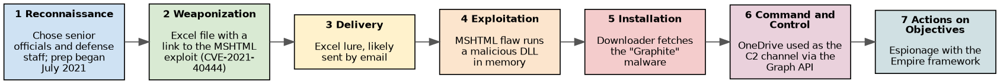

# Incident Response and the Cyber Kill Chain

Study notes in my own words (CompTIA Security+ topic). Case study: [the MSHTML and Graphite espionage campaign](../case-studies/mshtml-graphite-espionage-campaign.md). Related: [database security](database-security.md).

## 1. Incident response process
An **incident** is an event that threatens the confidentiality, integrity or availability of systems or data. Response follows a repeating cycle:
| Phase | Purpose | Examples |
|---|---|---|
| **Preparation** | Be ready before anything happens | Response plan and roles, tools, training, contact lists, backups |
| **Identification** | Detect and confirm an incident | Alerts, log review, user reports; decide severity |
| **Containment** | Stop the spread | Isolate hosts, disable accounts, block addresses |
| **Eradication** | Remove the cause | Delete malware, close the vulnerability, rebuild systems |
| **Recovery** | Return to normal | Restore from clean backups, monitor closely |
| **Post-incident activity** | Learn | Lessons-learned review, update the plan, report |

The lessons learned feed back into preparation: the cycle repeats.

## 2. The incident response plan
- **Roles and a CSIRT/IR team** (leader, analysts, legal, communications, management).
- **Playbooks** for common cases (phishing, ransomware, data loss).
- **Communication plan:** who is told, when and how, including regulators and affected people.
- **Escalation and severity levels.**
- **Evidence handling:** chain of custody and the **order of volatility** (collect the most short-lived evidence first: memory, then network state, then disk, then logs and backups).
- **Exercises:** tabletop and live drills.

## 3. Data sources for identification
| Source | Value |
|---|---|
| Logs (operating system, application, firewall, authentication) | What happened and when |
| **SIEM** | Collects and correlates logs from everywhere and raises alerts |
| Packet captures and NetFlow | What crossed the network |
| Endpoint detection and response (EDR) | Process-level activity on hosts |
| Threat intelligence | Known bad addresses, hashes and techniques |

## 4. Mitigation techniques
Isolating or quarantining systems, segmentation, blocking at the firewall or DNS, disabling accounts, revoking credentials, application allow-listing and patching.

## 5. The Cyber Kill Chain (7 stages)
Lockheed Martin's model describes the steps of an intrusion. Stop it at any stage and the attack fails.
| # | Stage | What the attacker does | Example defender actions |
|---|---|---|---|
| 1 | **Reconnaissance** | Researches and scans targets | Limit public information; monitor scanning |
| 2 | **Weaponization** | Builds the attack (exploit plus payload) | Threat intelligence |
| 3 | **Delivery** | Sends it (email, web, USB) | Email filtering, web proxies, training |
| 4 | **Exploitation** | Triggers a vulnerability to run code | Patching, hardening, application controls |
| 5 | **Installation** | Installs malware and persistence | EDR, application allow-listing, file integrity monitoring |
| 6 | **Command and control (C2)** | Establishes remote control | Egress filtering, DNS and proxy monitoring |
| 7 | **Actions on objectives** | Steals, destroys or encrypts data | Data loss prevention, segmentation, backups |

### Which stage confirms malware is present?
**Stage 5, Installation.** Delivery only means a malicious file arrived, and exploitation means code was triggered, but installation is where malware is placed and made to persist on the host. Finding a new unauthorized service, startup entry, dropped file or implant (through EDR, file-integrity monitoring or a hash match) is the evidence that malware is present in the environment. Stage 6 (C2 traffic) is the other strong confirmation, and often how it is first noticed.

### Kill chain vs incident response
The kill chain describes the *attacker's* path; the IR process describes the *defender's* response. Detecting an attack at an early kill chain stage lets the response end before any data is lost.

## 6. Quick checklist
- [ ] A written, current IR plan that people have read
- [ ] Logging and a central place to look at it
- [ ] Tested backups
- [ ] Practiced the plan at least once
- [ ] A contact list including legal and communications

## Sources
- [NIST SP 800-61 Rev. 2: Computer Security Incident Handling Guide](https://csrc.nist.gov/pubs/sp/800/61/r2/final)
- [Lockheed Martin Cyber Kill Chain](https://www.lockheedmartin.com/en-us/capabilities/cyber/cyber-kill-chain.html)
