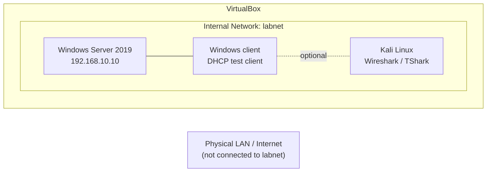

# Isolated Virtual Lab Environment

## Overview

Build a small, isolated VirtualBox network for the Windows Server and network-service labs in this folder. A Windows client is used for Windows-specific tasks. Kali Linux is optional: it can act as a Linux client and run Wireshark/TShark, but it is not required to use Wireshark or administer Windows Server.

## Skills Demonstrated

- Plan a small IPv4 lab network and assign consistent host addresses.
- Build isolated VirtualBox guests and use snapshots for recovery.
- Identify where to capture traffic and the limits of a separate analyzer VM.
- Avoid competing DHCP servers during DHCP configuration exercises.

## Lab Environment

| Role | System | Purpose |
|---|---|---|
| Host | Your physical computer | Runs VirtualBox; does not bridge the lab to the home or office LAN. |
| Server | Windows Server 2019 | Hosts the DHCP, DNS, IIS, FTP, and RDP services used in the runbooks. |
| Client | Windows 10/11 VM | Tests Windows client settings and connects to the lab services. |
| Optional Linux client/analyzer | Kali Linux VM | Generates Linux client traffic and can run Wireshark or TShark. Not required for the Windows service labs. |

Use the exact operating system and VirtualBox versions you installed in your lab notes. The IP addresses below are documentation examples; change them if they conflict with a network you use elsewhere.

## Requirements

- A computer with hardware virtualization enabled (Intel VT-x or AMD-V/SVM).
- Oracle VirtualBox and enough memory/storage for the guests you plan to run. About 16 GB host RAM is a practical starting point for two guests; running three guests together may need more.
- A Windows Server 2019 evaluation ISO from [Microsoft Evaluation Center](https://www.microsoft.com/en-us/evalcenter/evaluate-windows-server-2019).
- A Windows client VM for client-specific validation. Use installation media and licenses according to their terms.
- Optional Kali Linux VM for Linux client exercises or Wireshark/TShark use.
- Lab-only accounts and passwords. Never reuse personal or production credentials.

## Network Topology

All lab guests use the same VirtualBox **Internal Network** name, such as `labnet`. It isolates their virtual Ethernet segment from the host and physical network. Do not add a bridged adapter for these exercises.

### Where to capture packets

Wireshark is packet-analysis software; Kali is only one operating system on which it can run. Install Wireshark on Kali, Windows, or another supported endpoint as appropriate. Capture on the interface that sends or receives the test traffic. A Kali VM on the same virtual network can observe its own traffic and shared broadcast/multicast traffic; it does not automatically see unicast traffic exchanged only between the Windows client and server. For those exchanges, capture on one endpoint or configure an authorized virtual switch mirror/TAP.

The Wireshark guides use Kali commands where useful. Replace those commands with the Windows equivalent when using a Windows client (for example, `ping -n 4` instead of `ping -c 4`). The user interface and display filters are the same across platforms.

## Build Instructions

1. Create the Windows Server VM from the evaluation ISO. Assign a static address from the shared configuration below.
2. Create a Windows client VM. Create the optional Kali VM only if you need a Linux client or prefer Kali for packet analysis.
3. For each VM, open **Settings > Network > Adapter 1**. Select **Enable Network Adapter**, set **Attached to: Internal Network**, and enter the same network name (for example, `labnet`). Do not select Bridged Adapter.
4. For DHCP labs, configure the Windows Server DHCP role to serve the internal lab network. Give the server its static address before installing/configuring DHCP.
5. Before DHCP testing, check that no other DHCP service is attached to `labnet` (see the note below). Keep a second NAT/bridged adapter off during the DHCP test unless you have deliberately bound services and client traffic to the correct interface.
6. Set the test client NIC to obtain an address automatically for DHCP exercises. Use static client settings only in labs that call for them.
7. Name VMs and accounts with generic lab identifiers. Take a clean snapshot of each VM before installing roles or changing security settings.
8. Follow the recommended order below. Restore the snapshot or undo each lab's changes before starting a lab that expects the original baseline.

### VirtualBox DHCP and address conflicts

VirtualBox can provide its own DHCP service on **Host-Only** and **NAT Network** segments; VirtualBox can also attach a DHCP server to a named **Internal Network**. If both VirtualBox and Windows Server answer DHCP requests on the same segment, a client may accept an address or options from the wrong server. The VirtualBox manual documents DHCP services and their configuration for these network types.

For this lab, use the `labnet` Internal Network and let Windows Server provide DHCP. Do not create a VirtualBox DHCP server for `labnet`. Check configured VirtualBox servers in **VirtualBox Manager > Tools > Network Manager** or with `VBoxManage list dhcpservers`. If one is configured for `labnet`, disable that server with `VBoxManage dhcpserver modify --network=labnet --disable`. If you deliberately use a Host-Only network instead, disable its VirtualBox DHCP server in **VirtualBox Manager > Tools > Network Manager > Host-Only Networks > DHCP Server** before testing Windows DHCP. For a NAT Network, disable its DHCP service or use a separate planned segment. Verify the client’s **DHCP Server** value after renewal; it should identify the Windows Server lab VM.

If a second adapter is deliberately used for Internet access, keep it on a separate NAT segment and scope the Windows DHCP role and client tests to `labnet`. Disconnect that adapter while validating DHCP if you are unsure which interface is being used. See the [VirtualBox networking manual](https://download.virtualbox.org/virtualbox/7.2.22/UserManual.pdf).

## Shared Configuration

| Setting | Example value | Notes |
|---|---|---|
| Internal network name | `labnet` | Must match on each guest adapter. |
| IPv4 network | `192.168.10.0/24` | Private lab-only example subnet. |
| Windows Server address | `192.168.10.10` | Configure statically; use as DNS server in the DHCP example. |
| Example DHCP scope | `192.168.10.100–192.168.10.200` | Exclude `.100–.109` only if you intend to reserve those addresses; the DHCP runbook uses that example exclusion. |
| DNS zone | `lab.test` | Reserved for testing; do not use a real public domain. |
| Lab accounts | `ftpuser`, `rdpuser` | Use disposable passwords and delete or reset after testing. |

Use the same values across dependent labs or document any changes. `192.168.10.1` in the DHCP options is a placeholder router address; this isolated topology has no router by default, so do not expect Internet access through it.

## Recommended Lab Order

1. [Windows Firewall: Open a Port](windows-firewall-open-a-port.md)
2. [DHCP Server](dhcp-server-windows-server-2019.md)
3. [DNS Server](dns-server-windows-server-2019.md)
4. [IIS Web Server](iis-web-server-windows-server-2019.md)
5. [FTP Server](ftp-server-windows-server-2019.md)
6. [Remote Desktop (RDP)](rdp-remote-desktop-windows-server-2019.md)
7. [Wireshark: Setup and Basics](wireshark-01-setup-and-basics.md)
8. [Wireshark: ICMP, TCP, and HTTP](wireshark-02-icmp-tcp-http.md)
9. [Wireshark: FTP and FTPS](wireshark-03-ftp-credentials.md) after the FTP lab.

## Security & Documentation Practices

- Use Internal Network mode for lab traffic; do not expose lab services to a home, office, or public network.
- Use unique lab-only credentials. Never include passwords or secrets in screenshots, notes, or captures.
- Capture only traffic you are authorized to inspect. Treat PCAPs as sensitive; do not publish raw `.pcap` or `.pcapng` files.
- Redact account names, MAC addresses, IP addresses, hostnames, and device identifiers from screenshots when they identify a real environment.
- Record the OS/tool versions, interface, network mode, command, and observed output. Separate expected behavior from results you actually observed.
- Capture on a VM endpoint for its traffic. Do not assume Wireshark on the physical host or a third VM sees all traffic on an Internal Network.
- Take a VM snapshot before a change and record how to restore the original state.

