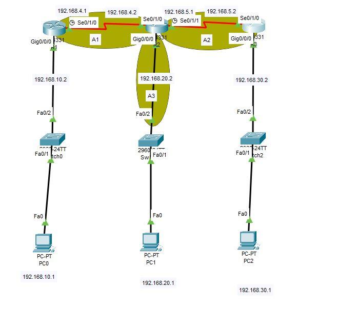

# Lab: Single-Area OSPF with Three Routers (Cisco Packet Tracer)

**Goal:** connect three routers with serial links, give each router a LAN, run single-area OSPF so every network learns every other network automatically, and prove it with neighbor tables, routing tables and pings.

**Who this is for:** learners who finished the [static routing lab](packet-tracer-static-routing.md) or understand static routes. Concepts are in [Static routing vs OSPF](../notes/static-routing-and-ospf.md). Setup and cables: [Packet Tracer setup](packet-tracer-setup.md).

**Time:** about 60 minutes.

> **How to use this file:** runbook plus write-up. Take screenshots OS1 to OS9 into `../screenshots/packet-tracer/` using the file names below, paste your own output into **My results**, and save the finished `.pkt`.

## My starting point
This is my first draft of the topology before configuration. The red serial links are down because the interfaces were not configured yet, and the addresses on this draft are placeholders. **The addressing plan below is the one to use.**



## Quick checklist
- [ ] Build and cable the topology
- [ ] Configure interfaces and serial clocks
- [ ] Configure OSPF on all three routers
- [ ] Check neighbors, routes and costs
- [ ] Ping across the whole network and trace the path
- [ ] Watch OSPF react to a failure
- [ ] Optional: add OSPF authentication
- [ ] Screenshots OS1 to OS9, save the `.pkt`, fill in results

## 1. Topology
Three routers in a chain: R1 to R2 to R3. Each router has one LAN with a switch and a PC.

| From | To | Cable |
|---|---|---|
| R1 `Se0/1/0` (DCE) | R2 `Se0/1/0` | Serial DCE |
| R2 `Se0/1/1` (DCE) | R3 `Se0/1/0` | Serial DCE |
| R1 `Gi0/0/0` | SW1 `Gig0/1` | Straight-through |
| R2 `Gi0/0/0` | SW2 `Gig0/1` | Straight-through |
| R3 `Gi0/0/0` | SW3 `Gig0/1` | Straight-through |
| SW1, SW2, SW3 `Fa0/1` | PC0, PC1, PC2 `Fa0` | Straight-through |

- 📸 **OS1** `os01-topology-complete.png` (interfaces and addresses labeled)

## 2. Addressing plan

| Network | Subnet | Wildcard | Addresses |
|---|---|---|---|
| R1 to R2 link | 192.168.4.0/30 | 0.0.0.3 | R1 `Se0/1/0` .1, R2 `Se0/1/0` .2 |
| R2 to R3 link | 192.168.5.0/30 | 0.0.0.3 | R2 `Se0/1/1` .1, R3 `Se0/1/0` .2 |
| R1 LAN | 192.168.10.0/24 | 0.0.0.255 | R1 `Gi0/0/0` .1, SW1 .2, PC0 .10 |
| R2 LAN | 192.168.20.0/24 | 0.0.0.255 | R2 `Gi0/0/0` .1, SW2 .2, PC1 .10 |
| R3 LAN | 192.168.30.0/24 | 0.0.0.255 | R3 `Gi0/0/0` .1, SW3 .2, PC2 .10 |

LAN masks are `255.255.255.0`; link masks are `255.255.255.252`. PCs use the router's `.1` as default gateway.

**Wildcard masks:** OSPF `network` statements use a *wildcard* mask, the inverse of the subnet mask (`255.255.255.252` becomes `0.0.0.3`, `255.255.255.0` becomes `0.0.0.255`). A `0` bit means "must match".

## 3. Configure interfaces
### R1
```text
enable
configure terminal
hostname R1
interface GigabitEthernet0/0/0
 ip address 192.168.10.1 255.255.255.0
 no shutdown
interface Serial0/1/0
 ip address 192.168.4.1 255.255.255.252
 clock rate 64000
 no shutdown
```
### R2
```text
enable
configure terminal
hostname R2
interface GigabitEthernet0/0/0
 ip address 192.168.20.1 255.255.255.0
 no shutdown
interface Serial0/1/0
 ip address 192.168.4.2 255.255.255.252
 no shutdown
interface Serial0/1/1
 ip address 192.168.5.1 255.255.255.252
 clock rate 64000
 no shutdown
```
### R3
```text
enable
configure terminal
hostname R3
interface GigabitEthernet0/0/0
 ip address 192.168.30.1 255.255.255.0
 no shutdown
interface Serial0/1/0
 ip address 192.168.5.2 255.255.255.252
 no shutdown
```
Switches: give each a VLAN 1 address (`.2` in its LAN) and `ip default-gateway` set to the router's `.1`, as in the [static routing lab](packet-tracer-static-routing.md). Set each PC to `.10` with its gateway.

- [ ] `show ip interface brief` on each router: all used interfaces `up/up`
- 📸 **OS2** `os02-interface-brief.png`

## 4. Configure OSPF
Same process ID on all three is conventional (`1`); it only has local meaning. All networks go in **area 0**. The `router-id` gives each router a stable identity. `passive-interface` stops OSPF from sending Hellos toward the LAN, where only PCs live.

### R1
```text
router ospf 1
 router-id 1.1.1.1
 network 192.168.4.0 0.0.0.3 area 0
 network 192.168.10.0 0.0.0.255 area 0
 passive-interface GigabitEthernet0/0/0
end
copy running-config startup-config
```
### R2
```text
router ospf 1
 router-id 2.2.2.2
 network 192.168.4.0 0.0.0.3 area 0
 network 192.168.5.0 0.0.0.3 area 0
 network 192.168.20.0 0.0.0.255 area 0
 passive-interface GigabitEthernet0/0/0
end
copy running-config startup-config
```
### R3
```text
router ospf 1
 router-id 3.3.3.3
 network 192.168.5.0 0.0.0.3 area 0
 network 192.168.30.0 0.0.0.255 area 0
 passive-interface GigabitEthernet0/0/0
end
copy running-config startup-config
```
- 📸 **OS3** `os03-ospf-configuration.png` (`show running-config | section ospf`)

## 5. Verify
- [ ] **Neighbors:** `show ip ospf neighbor`. R2 should list two neighbors (1.1.1.1 and 3.3.3.3), R1 and R3 one each, all `FULL`. On serial point-to-point links the DR column shows `-` because no election happens
- 📸 **OS4** `os04-ospf-neighbors.png`
- [ ] **Routes:** `show ip route ospf` on R1 should show `O` entries for `192.168.5.0/30`, `192.168.20.0/24` and `192.168.30.0/24`, all via `192.168.4.2`
- 📸 **OS5** `os05-r1-ospf-routes.png`
- [ ] **Costs:** with default bandwidths (serial 1544 kbps costs 64, Gigabit costs 1) expect on R1: `192.168.20.0/24` at `[110/65]`, `192.168.5.0/30` at `[110/128]`, `192.168.30.0/24` at `[110/129]`. The `110` is OSPF's administrative distance
- [ ] **More detail:** `show ip protocols` (router ID, networks, passive interfaces) and `show ip ospf interface brief`
- 📸 **OS6** `os06-show-ip-protocols.png`
- [ ] **End to end:** from PC0, `ping 192.168.30.10` and `tracert 192.168.30.10`. The trace should show `192.168.10.1`, `192.168.4.2`, `192.168.5.2`, then `192.168.30.10`
- 📸 **OS7** `os07-ping-and-tracert.png`

## 6. Watch OSPF react
- [ ] On R2, `shutdown` interface `Serial0/1/1`. After the dead timer (about 40 seconds) R1's route to `192.168.30.0/24` disappears. `show ip ospf neighbor` on R2 shows only R1
- [ ] `no shutdown` it again and watch the neighbor return to `FULL` and the route reappear
- 📸 **OS8** `os08-link-failure-and-recovery.png`

This is the main advantage over static routes: nobody had to edit a route.

## 7. Optional: authenticate OSPF neighbors
Without authentication, any router that joins the segment can inject routes. Add MD5 authentication on a link (both ends must match). Use a lab-only key:
```text
interface Serial0/1/0
 ip ospf message-digest-key 1 md5 <lab-only-key>
 ip ospf authentication message-digest
```
Configure the same on the other end. If you configure only one end, the neighbor drops, which proves the control works. Restore both ends afterwards.
- 📸 **OS9** `os09-ospf-authentication.png`

## 8. Screenshot shot list and redaction

| ID | File | Shows | Redact |
|---|---|---|---|
| OS1 | `os01-topology-complete.png` | Final topology | Real names used as hostnames |
| OS2 | `os02-interface-brief.png` | Interfaces up | Nothing |
| OS3 | `os03-ospf-configuration.png` | OSPF config | Any key (use a placeholder, never a real one) |
| OS4 | `os04-ospf-neighbors.png` | Neighbors FULL | Nothing |
| OS5 | `os05-r1-ospf-routes.png` | OSPF routes with costs | Nothing |
| OS6 | `os06-show-ip-protocols.png` | OSPF process details | Nothing |
| OS7 | `os07-ping-and-tracert.png` | Cross-network reachability | Nothing |
| OS8 | `os08-link-failure-and-recovery.png` | Failover | Nothing |
| OS9 | `os09-ospf-authentication.png` | Authentication | The key |

## 9. Concepts to explain
- **Link-state routing:** each router builds a full map from LSAs and runs the shortest path first algorithm.
- **Single area:** all routers share one area, Area 0, which is fine for a small network.
- **Neighbors and adjacency:** Hello packets find neighbors; `FULL` means databases are synchronized.
- **Cost** is the sum of interface costs along a path; lower wins.
- **Router ID** identifies the router in OSPF.
- **Passive interface:** advertise the LAN but do not form neighbors on it.
- **Convergence:** the network re-learns routes by itself after a change.

## 10. Security connection (for the short answers)
- **Rogue routers:** without authentication a device that speaks OSPF can inject or poison routes and redirect traffic. MD5 or SHA authentication, passive interfaces, and shutting unused ports reduce this.
- **Attack surface:** every routing protocol you enable adds something to monitor. Enable it only where needed.
- **Availability:** OSPF reroutes around failures, which supports the "A" in the CIA triad, but a misconfiguration can also take the network down quickly.
- **Least privilege:** `passive-interface` keeps routing traffic away from user ports.
- **Monitoring:** unexpected new neighbors or route changes are early warning signs worth logging.

## 11. Troubleshooting

| Symptom | Likely cause | Fix |
|---|---|---|
| No neighbors | Serial link down, subnet mismatch, passive interface on the link, or an area mismatch | `show ip interface brief`, check masks, `show ip protocols` |
| Neighbor stuck in `INIT` or `EXSTART` | One-way communication or an MTU or authentication mismatch | Check both ends and keys |
| Neighbors `FULL` but no routes for a LAN | LAN missing from a `network` statement or wrong wildcard | Correct the `network` statement |
| Wrong wildcard mask | Wildcard written like a subnet mask | Use `0.0.0.3` and `0.0.0.255` here |
| Duplicate router ID | Two routers with the same ID | Set unique `router-id` values, then `clear ip ospf process` |
| Serial link red | No clock rate on the DCE end | Add `clock rate 64000` |
| PC cannot reach another LAN | Missing default gateway on the PC | Fix the gateway |

## 12. My results (fill in after doing the lab)
Paste your own output.
- **Final topology:** *(OS1)*
- **Neighbor table:** *(paste `show ip ospf neighbor`)*
- **OSPF routes and costs:** *(paste `show ip route ospf`)*
- **Failover observation:** *(what changed and how long it took)*
- **Problems I hit and how I fixed them:**
- **How this relates to security:** *(use section 10)*
- **What I want to learn next:** *(for example multi-area OSPF, route filtering, or ACLs)*

## Sources and notes
Cisco IOS commands as taught in standard networking courses; OSPF behavior per [RFC 2328](https://www.rfc-editor.org/rfc/rfc2328); costs calculated from the default 100 Mbps reference bandwidth. Packet Tracer versions differ slightly, so compare your own output with the expectations above. Concepts: [Static routing vs OSPF](../notes/static-routing-and-ospf.md).
