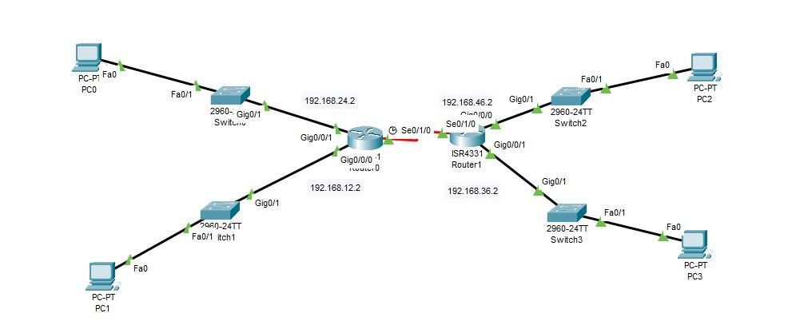

# Lab: Static Routing Between Two Routers with Subnetted LANs (Cisco Packet Tracer)

**Goal:** build a small network of two routers and four LANs, divide one address block into `/28` subnets, connect the routers with a serial link, add static routes, and prove a PC on one side can ping a PC on the other.

**Who this is for:** learners who know basic IP addressing. Read [subnetting and CIDR](../notes/subnetting-and-cidr.md) first if the `/28` math is new. Setup, cables and the DCE clock are explained in [Packet Tracer setup](packet-tracer-setup.md).

**Time:** about 60 minutes.

> **How to use this file:** runbook plus write-up. Do the steps, take screenshots SR1 to SR9 into `../screenshots/packet-tracer/` using the file names below, paste your own command output into the **My results** section, and save the finished `.pkt`.

## My starting point
This is my first draft of the topology, before any configuration. The red serial link is down because the interfaces were not configured yet, and the addresses on this draft are placeholders. **The addressing plan below is the one to use.**



## Quick checklist
- [ ] Place and cable the devices
- [ ] Work out the addressing plan (use the table below, or check it yourself)
- [ ] Configure router interfaces, the serial clock, and switch management IPs
- [ ] Set PC addresses and gateways
- [ ] Add static routes on both routers
- [ ] Test with ping and traceroute
- [ ] Break something on purpose and fix it
- [ ] Screenshots SR1 to SR9, save the `.pkt`, fill in results

## 1. Topology
Two routers (R1, R2), four switches (SW1 to SW4), four PCs (PC0 to PC3). Each router connects two switches, and the routers are joined by a serial link.

| From | To | Cable |
|---|---|---|
| PC0 `Fa0` | SW1 `Fa0/1` | Straight-through |
| SW1 `Gig0/1` | R1 `Gi0/0/0` | Straight-through |
| PC1 `Fa0` | SW2 `Fa0/1` | Straight-through |
| SW2 `Gig0/1` | R1 `Gi0/0/1` | Straight-through |
| PC2 `Fa0` | SW3 `Fa0/1` | Straight-through |
| SW3 `Gig0/1` | R2 `Gi0/0/0` | Straight-through |
| PC3 `Fa0` | SW4 `Fa0/1` | Straight-through |
| SW4 `Gig0/1` | R2 `Gi0/0/1` | Straight-through |
| R1 `Se0/1/0` (DCE) | R2 `Se0/1/0` | Serial DCE |

- 📸 **SR1** `sr01-topology-complete.png` (all devices, with interface names and addresses labeled)

## 2. Addressing plan
Start from `192.168.10.0/24`. Use `/28` blocks (14 usable hosts each) for the four LANs and a `/30` (2 usable hosts) for the router link.

| Network | Subnet | Router gateway (first usable) | Switch (second usable) | PC (last usable) | Broadcast |
|---|---|---|---|---|---|
| LAN1 (R1 `Gi0/0/0`) | 192.168.10.0/28 | .1 | .2 | PC0 .14 | .15 |
| LAN2 (R1 `Gi0/0/1`) | 192.168.10.16/28 | .17 | .18 | PC1 .30 | .31 |
| LAN3 (R2 `Gi0/0/0`) | 192.168.10.32/28 | .33 | .34 | PC2 .46 | .47 |
| LAN4 (R2 `Gi0/0/1`) | 192.168.10.48/28 | .49 | .50 | PC3 .62 | .63 |
| WAN (serial) | 192.168.10.64/30 | R1 `.65`, R2 `.66` | n/a | n/a | .67 |

All LAN masks are `255.255.255.240`; the WAN mask is `255.255.255.252`. On the WAN `/30`, `.65` is the first usable and `.66` the last usable.

**Why the routes are summaries:** R1 needs to reach LAN3 and LAN4, which are `192.168.10.32/28` and `192.168.10.48/28`. Together they equal one block, `192.168.10.32/27` (mask `255.255.255.224`). Likewise R2 reaches LAN1 and LAN2 with `192.168.10.0/27`. One route each instead of two.

## 3. Configure the routers
### R1
```text
enable
configure terminal
hostname R1
interface GigabitEthernet0/0/0
 description LAN1
 ip address 192.168.10.1 255.255.255.240
 no shutdown
interface GigabitEthernet0/0/1
 description LAN2
 ip address 192.168.10.17 255.255.255.240
 no shutdown
interface Serial0/1/0
 description WAN to R2
 ip address 192.168.10.65 255.255.255.252
 clock rate 64000
 no shutdown
exit
ip route 192.168.10.32 255.255.255.224 192.168.10.66
end
copy running-config startup-config
```
### R2
```text
enable
configure terminal
hostname R2
interface GigabitEthernet0/0/0
 description LAN3
 ip address 192.168.10.33 255.255.255.240
 no shutdown
interface GigabitEthernet0/0/1
 description LAN4
 ip address 192.168.10.49 255.255.255.240
 no shutdown
interface Serial0/1/0
 description WAN to R1
 ip address 192.168.10.66 255.255.255.252
 no shutdown
exit
ip route 192.168.10.0 255.255.255.224 192.168.10.65
end
copy running-config startup-config
```
`clock rate` goes only on the DCE end (R1 here, the end with the clock icon). If your DCE end is on R2, move that line.

## 4. Configure the switches
Each switch gets a management address on VLAN 1 and a default gateway so you can manage it from other subnets.
```text
enable
configure terminal
hostname SW1
interface vlan 1
 ip address 192.168.10.2 255.255.255.240
 no shutdown
exit
ip default-gateway 192.168.10.1
end
copy running-config startup-config
```
| Switch | VLAN 1 address | Gateway |
|---|---|---|
| SW1 | 192.168.10.2 | 192.168.10.1 |
| SW2 | 192.168.10.18 | 192.168.10.17 |
| SW3 | 192.168.10.34 | 192.168.10.33 |
| SW4 | 192.168.10.50 | 192.168.10.49 |

## 5. Configure the PCs
Desktop, **IP Configuration**, static, mask `255.255.255.240`:
| PC | IP address | Default gateway |
|---|---|---|
| PC0 | 192.168.10.14 | 192.168.10.1 |
| PC1 | 192.168.10.30 | 192.168.10.17 |
| PC2 | 192.168.10.46 | 192.168.10.33 |
| PC3 | 192.168.10.62 | 192.168.10.49 |

- 📸 **SR2** `sr02-pc-ip-configuration.png`

## 6. Verify
- [ ] On each router: `show ip interface brief`. Every used interface should be `up/up`. A serial interface that is `down/down` points to a missing clock rate, a wrong cable, or no serial module
- 📸 **SR3** `sr03-r1-interface-brief.png`
- 📸 **SR4** `sr04-r2-interface-brief.png`
- [ ] On R1: `show ip route`. Expect `C` and `L` entries for its own networks and one static entry like `S 192.168.10.32/27 [1/0] via 192.168.10.66`
- 📸 **SR5** `sr05-r1-routing-table.png`
- 📸 **SR6** `sr06-r2-routing-table.png`
- [ ] From PC0 (Desktop, Command Prompt): `ping 192.168.10.62`. In Packet Tracer the **first** ping often times out while ARP resolves; the rest should succeed
- 📸 **SR7** `sr07-ping-pc0-to-pc3.png`
- [ ] `tracert 192.168.10.62` from PC0 should show the path `192.168.10.1`, then `192.168.10.66`, then `192.168.10.62` (three hops)
- 📸 **SR8** `sr08-tracert.png`

## 7. Try variations
| Variation | Command (on R1) | What it teaches |
|---|---|---|
| Exit-interface route | `ip route 192.168.10.32 255.255.255.224 Serial0/1/0` | Directly attached instead of next-hop |
| Default route | `ip route 0.0.0.0 0.0.0.0 192.168.10.66` | Gateway of last resort for a stub router |
| Floating static | `ip route 192.168.10.32 255.255.255.224 192.168.10.66 200` | A backup route with higher administrative distance |
Remove the previous route before trying another (`no ip route ...`) and re-test.

## 8. Break it, then fix it
- [ ] `shutdown` the serial interface on R2, ping from PC0, and read the error
- [ ] Remove R2's route back to LAN1 and LAN2 and ping again. The ping fails even though R1 can forward: **the reply has no way back**, so both routers need routes
- [ ] Give a PC the wrong gateway and see why it can ping only its own subnet
- 📸 **SR9** `sr09-failed-ping-and-fix.png`

## 9. Screenshot shot list and redaction

| ID | File | Shows | Redact |
|---|---|---|---|
| SR1 | `sr01-topology-complete.png` | Final topology with labels | Any real name used as a hostname |
| SR2 | `sr02-pc-ip-configuration.png` | PC addressing | Nothing |
| SR3 | `sr03-r1-interface-brief.png` | R1 interfaces up | Nothing |
| SR4 | `sr04-r2-interface-brief.png` | R2 interfaces up | Nothing |
| SR5 | `sr05-r1-routing-table.png` | R1 routes | Nothing |
| SR6 | `sr06-r2-routing-table.png` | R2 routes | Nothing |
| SR7 | `sr07-ping-pc0-to-pc3.png` | Successful ping | Nothing |
| SR8 | `sr08-tracert.png` | Path with three hops | Nothing |
| SR9 | `sr09-failed-ping-and-fix.png` | The failure and the fix | Nothing |

Everything here is a simulation with private example addresses, so little needs redacting. Check hostnames, banners and passwords.

## 10. Concepts to explain
- **Subnetting a `/24` into `/28`s:** 16 addresses per block, 14 usable, in steps of 16.
- **WAN links use `/30`:** exactly two usable addresses for a point-to-point link.
- **A static route has two parts:** the destination network and the way to reach it (next hop or exit interface).
- **Routes are needed in both directions.** Traffic that arrives but cannot return looks like "no connectivity".
- **Summarization** (CIDR) keeps routing tables small.
- **Default gateway:** how a host reaches any remote network.

## 11. Security connection (for the short answers)
- **Segmentation:** separate subnets are the boundary where access lists and firewalls go. Four LANs behind two routers can each get their own policy.
- **Static routes resist tampering** by routing-protocol messages, but they cannot reroute around failures (availability trade-off).
- **Least privilege on the network:** only the routes that are needed exist, so a PC cannot reach networks the design does not intend.
- **Device hardening:** `enable secret`, console and remote-access protections, and unused interfaces shut down (see [setup](packet-tracer-setup.md)).
- **Management plane:** the switch IPs let you administer devices remotely, which is also what an attacker would target. Restrict and secure it.

## 12. Troubleshooting

| Symptom | Likely cause | Fix |
|---|---|---|
| Serial link is red or `down/down` | No clock rate on the DCE end, wrong end, or no serial module | Add `clock rate 64000` on the DCE end; check cable and module |
| First ping times out, the rest succeed | ARP resolving | Normal; ping again |
| All pings to the far side fail | Missing or wrong static route, or no return route | Check `show ip route` on both routers |
| "Destination host unreachable" from a router | That router has no route to the destination | Add the route |
| PC reaches only its own subnet | Missing or wrong default gateway | Fix the gateway |
| Wrong results after a typo in the mask | Overlapping or mis-sized subnets | Re-check against the addressing table |
| Interface is `administratively down` | Missing `no shutdown` | Add it |

## 13. My results (fill in after doing the lab)
Paste your own output.
- **Final topology:** *(SR1)*
- **R1 routing table:** *(paste `show ip route`)*
- **R2 routing table:** *(paste `show ip route`)*
- **Ping and traceroute result:** *(SR7 and SR8)*
- **Problems I hit and how I fixed them:**
- **How this relates to security:** *(use section 11)*
- **What I want to learn next:** *(for example OSPF, ACLs to filter between the LANs, or VLANs)*

## Sources and notes
Cisco IOS commands as taught in standard networking courses; subnetting math checked with a script (no overlaps, correct summary routes, all PC pairs reachable at the first-hop router). Concepts: [Subnetting and CIDR](../notes/subnetting-and-cidr.md), [Static routing vs OSPF](../notes/static-routing-and-ospf.md). Packet Tracer versions differ slightly, so compare your own output with the expectations above.
