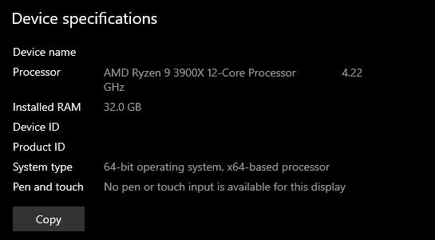
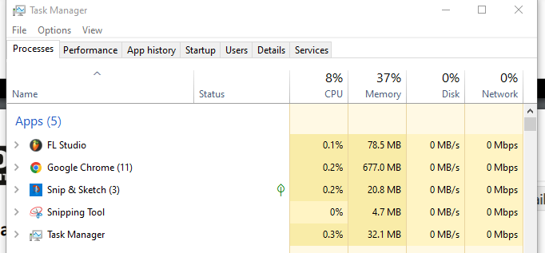
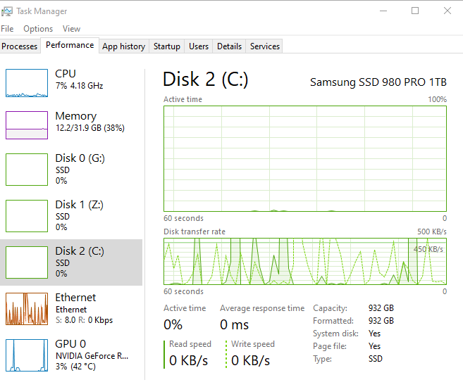
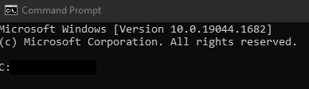
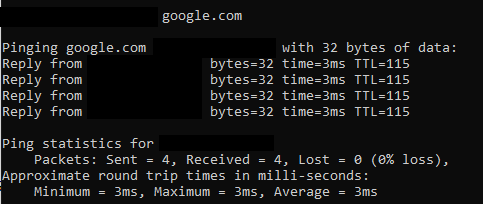
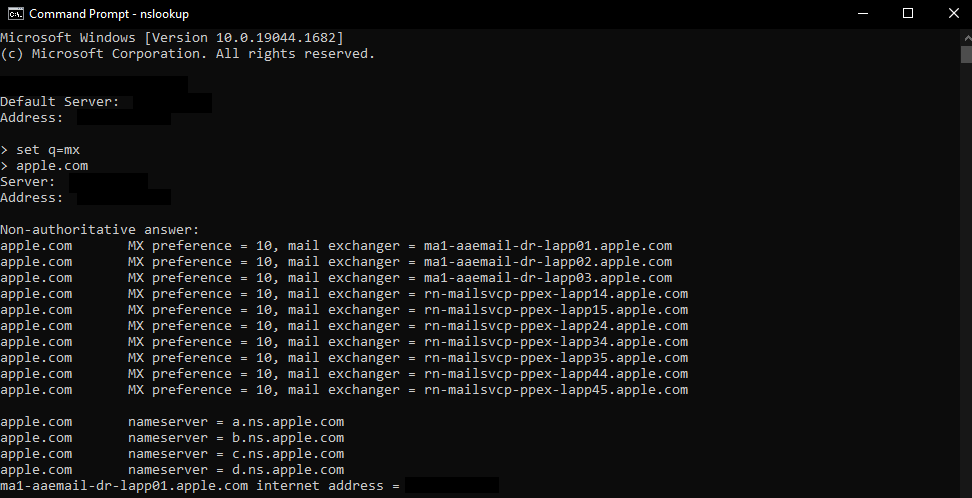
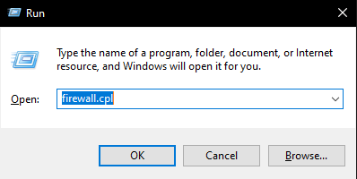
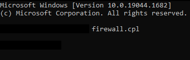
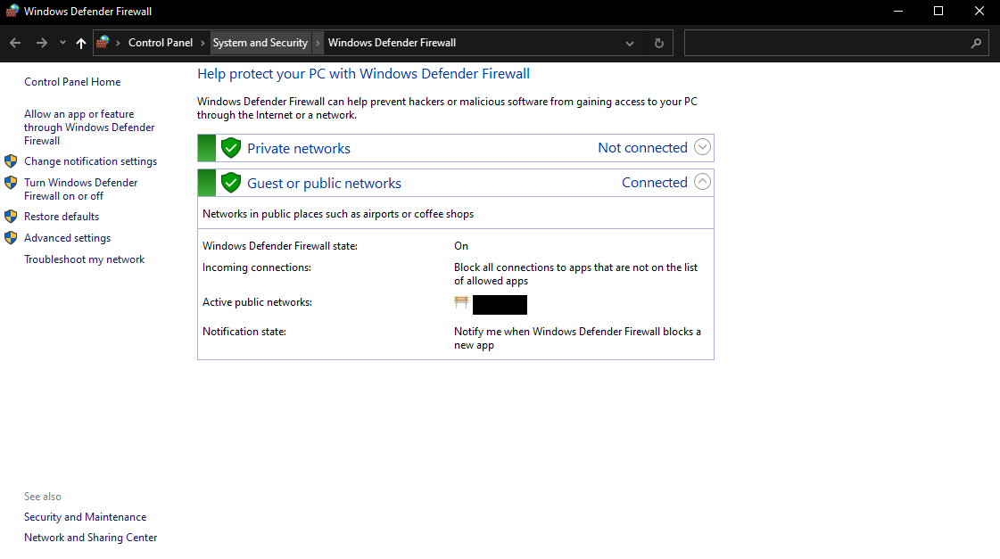

# Lab: System Information and Windows Admin Tools

**Goal:** Read a machine's hardware profile, monitor it, and use built-in Windows command-line and firewall tools. These are the first steps an IT or security analyst takes when triaging a machine.

## Part I: Hardware and performance

### Is my machine suitable for security labs?
A sensible baseline for running virtual labs is a 64-bit x86 CPU at 2 GHz or better (4 or more cores recommended) with virtualization support, 6 GB or more of RAM, 256 GB of storage, USB 3 and a modern Wi-Fi adapter. My machine has a 12-core Ryzen 9 at about 4.2 GHz and 32 GB RAM: roughly double the clock speed, three times the cores and over five times the RAM. That headroom matters because virtual machines (see the Wireshark and VirtualBox lab) are RAM-hungry.

*Device name, Device ID and Product ID are blacked out.*

### What the specs mean
| Spec | In my own words |
|---|---|
| Processor | Executes instructions. Clock speed and core count set how fast it works and how many tasks it handles at once. |
| Installed RAM | Short-term working memory for running programs. It clears on shutdown (volatile). |
| Device ID | Identifier for this specific device. |
| Product ID | Identifier for the Windows installation. Useful to support staff; changes on reinstall. |
| System type | A 64-bit OS on a 64-bit CPU can address more than 4 GB of RAM and process larger values than 32-bit. |

Other ways to open Windows Settings: **Win + I**, or **Start, then Settings**.

### Task Manager columns
- **CPU:** how busy the processor is, as a percentage of its capacity.
- **Memory:** how much RAM is in use.
- **Disk:** how busy the storage drive is (activity, not how full it is).
- **Network:** current traffic on the network adapters.
- **GPU:** load on the graphics processor.

**With extra applications open:** with five apps running (including Chrome with 11 tabs), the screenshots show memory at about 37-38% (12.2 of 31.9 GB), CPU at 7-8% and disk near 0%. Each app adds to memory use, and my large RAM leaves plenty of headroom.

**Three other things Task Manager can do:** end a frozen process, enable or disable startup apps, and review or clear app usage history.

**Why the performance graphs help with troubleshooting:** they show which resource is the bottleneck (pegged CPU, full RAM, busy disk, saturated network), so you fix the right thing. A process with unexpected CPU or network use can also be an early sign of malware.

## Part II: Command prompt and firewall

*The prompt shows the current working folder and that the shell is ready for input. It differs between machines because the profile folder is named after the account. Username is blacked out.*

| Command | What it does | What it returned |
|---|---|---|
| `driverquery` | Lists installed device drivers and properties | A table of driver names, types and dates |
| `ipconfig` | Shows TCP/IP configuration (IP, subnet, gateway, DNS) | My adapter addresses (not shown, private) |
| `ping google.com` | Sends 4 echo requests and times the replies | 4 sent, 4 received, 0% loss, about 3 ms |
| `nslookup`, then `set q=mx` | Queries DNS for a domain's mail servers | MX records and name servers for apple.com |

*Local DNS server, IPs and username are blacked out.*

**MX record:** a DNS record naming the mail servers that accept email for a domain, with a priority number (lower is preferred). **Two other record types:** SOA (authoritative zone information) and LOC (geographic location). **Purpose of DNS:** translating human-readable names into IP addresses.

### Run dialog and firewall
The Run box (**Win + R**) launches a program, folder or control panel applet by name. `control firewall.cpl` opens Windows Defender Firewall, and it also works from the command prompt.

*Wi-Fi network name is blacked out.*

- **Inbound rules** control traffic coming into the machine.
- **Outbound rules** control traffic leaving it, which helps stop malware from calling home.
- **Custom rules:** Windows Defender Firewall with Advanced Security, then Inbound or Outbound Rules, then **New Rule**. You write one to allow a specific app or port, or to block something the defaults allow.

## Why this matters for security
This lab covers the **risk-reduction** side of security: knowing what is on a system, watching its behavior, and restricting traffic with firewall rules (a **technical control**). For an IT employee, these tools are the baseline for spotting misconfigurations and suspicious activity.
