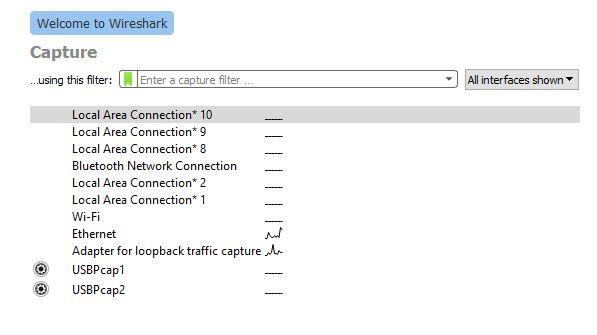
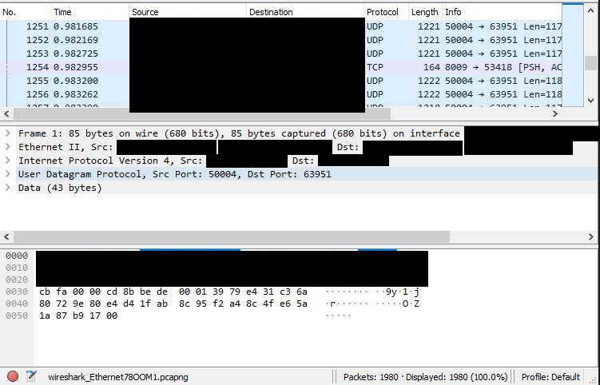
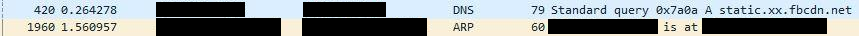
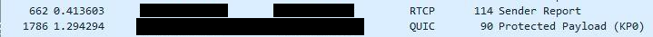
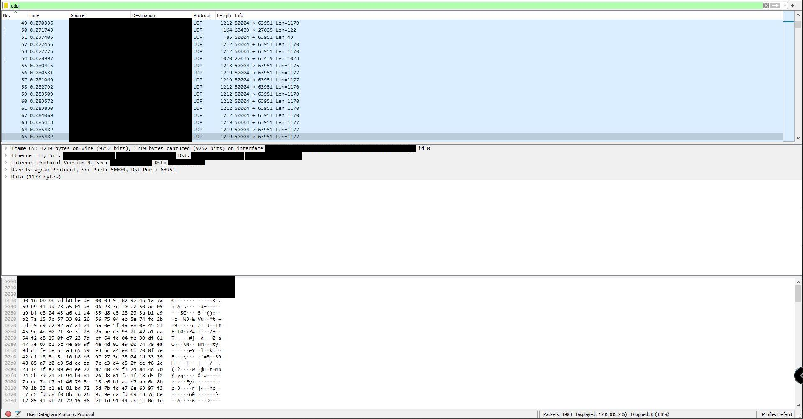
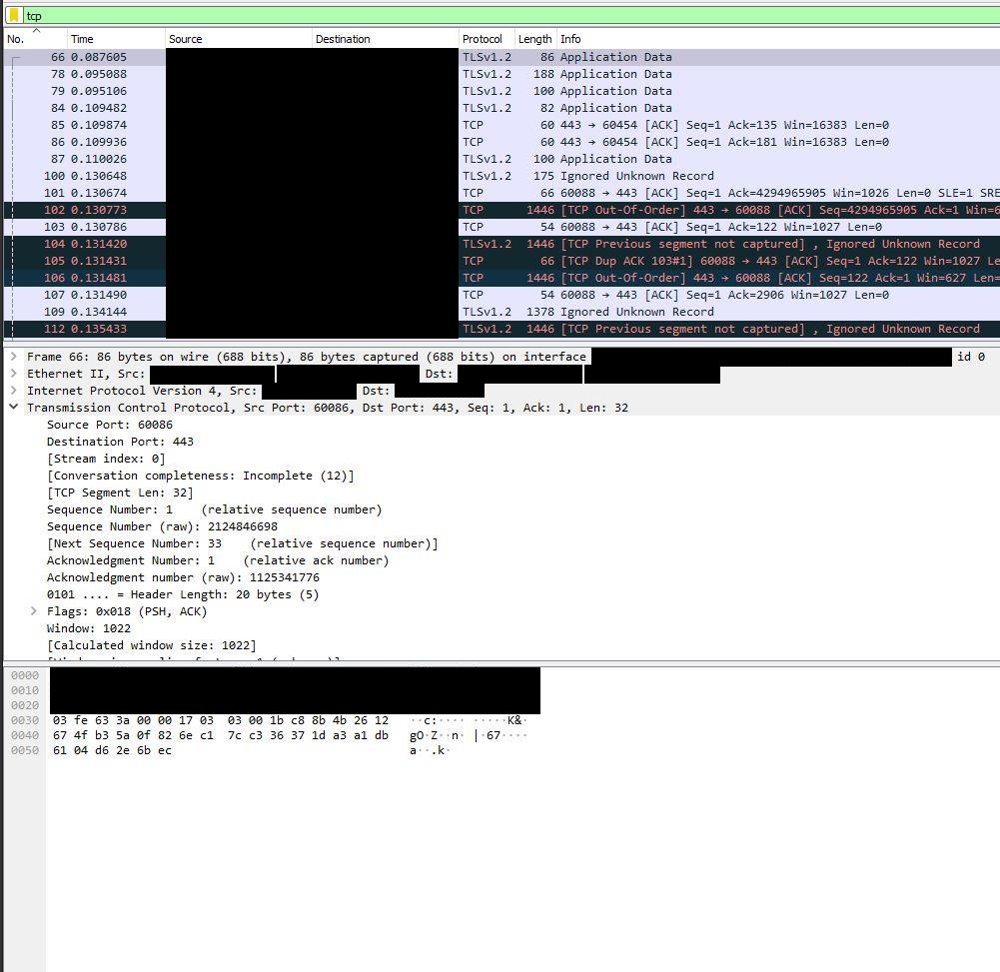
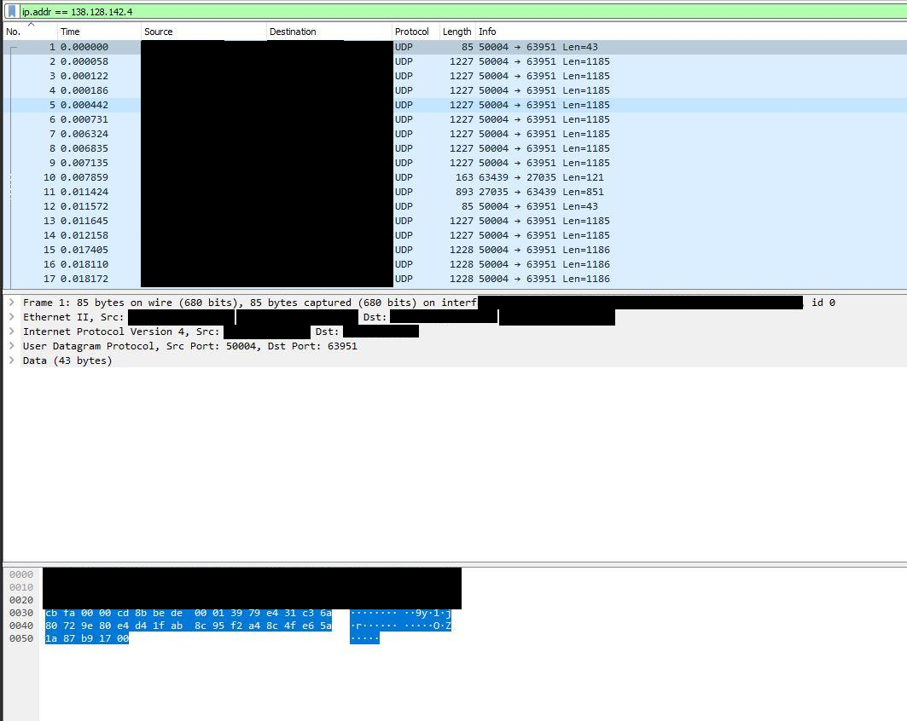
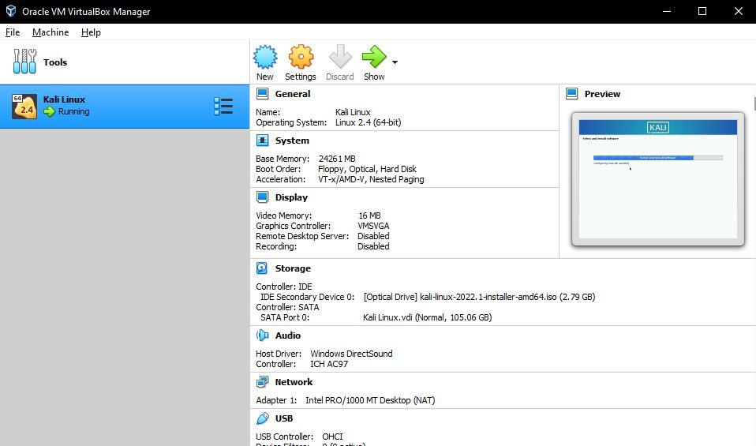

# Lab: Packet Analysis with Wireshark and a Kali VM in VirtualBox

**Goal:** Capture and inspect live network traffic, then build an isolated virtual machine for security testing.

> **Safety note:** Only capture traffic on networks you own or have written permission to monitor. These captures are from my own home network, and addresses are redacted.

## Part 1: Wireshark

**Why open source matters:** Wireshark is open source. Anyone can audit it for backdoors, report or fix bugs, and compile it for unusual platforms. For a tool that handles raw network data, being able to verify what it does builds trust.

### Interface list
The start screen lists every network interface on the machine (Wi-Fi, Ethernet, Bluetooth, loopback, USB capture). The small sparklines show live traffic, so you can pick the interface that is actually active.

### Packet list columns
`No.` is the packet's order in the capture. `Time` is seconds since the capture began. `Source` and `Destination` are the sending and receiving addresses. `Protocol` is the highest-level protocol identified. `Length` is the packet size in bytes. `Info` summarizes what the packet is doing.

### The three panes
1. **Packet List:** one line per packet.
2. **Packet Details:** the selected packet decoded layer by layer (frame, Ethernet, IP, TCP/UDP, application).
3. **Packet Bytes:** the same packet as raw hexadecimal and ASCII.

*Source and destination addresses and MAC addresses are blacked out.*

### Five protocols from my capture
| Protocol | What it does |
|---|---|
| **DNS** | Resolves domain names to IP addresses |
| **ARP** | Maps an IP address to a hardware (MAC) address on the local network |
| **UDP** | Fast, connectionless transport with no delivery guarantee (streaming, calls) |
| **TCP** | Reliable, connection-oriented transport (handshake, ordering, retransmission) |
| **QUIC** | Encrypted transport built on UDP, used by modern web traffic (HTTP/3) |

RTCP, which reports quality statistics for real-time calls, also showed up.

### Filters I ran

### Ten display filters beyond a single protocol name
| Filter | Use |
|---|---|
| `ip.addr == 10.0.0.5` | Traffic to or from one host |
| `ip.src == 10.0.0.5 && ip.dst == 10.0.0.9` | One direction between two hosts |
| `tcp.port == 443` | Anything on a given TCP port |
| `tcp.flags.syn == 1 && tcp.flags.ack == 0` | New connection attempts (useful for spotting scans) |
| `tcp.flags.reset == 1` | Connections being forcibly torn down |
| `tcp.stream eq 3` | Isolate one TCP conversation |
| `http.request` | HTTP requests only (GET, POST) |
| `dns.flags.rcode != 0` | DNS lookups that failed |
| `frame contains "password"` | Packets containing a string anywhere |
| `!arp && !dns` | Hide noisy protocols to see what is left |

### Why HTTPS matters
On plain HTTP, anyone on the same network who captures the traffic can read page content, form fields and credentials in clear text. HTTPS wraps that data in TLS encryption, so a sniffer sees only the handshake and unreadable ciphertext. Seeing this in Wireshark makes "use HTTPS" concrete.

### Should you use this on a network that is not yours?
No, not without explicit written authorization. Wireshark is legal software, but capturing other people's traffic without permission can break computer-misuse and wiretapping laws. Authorized use means a defined scope, which is what penetration-test rules of engagement spell out.

## Part 2: Kali Linux in VirtualBox

- **VirtualBox:** free hypervisor that runs virtual machines on an ordinary PC. Alternatives: VMware Workstation/Player, Hyper-V, Parallels, KVM/QEMU.
- **Kali Linux:** a Debian-based distribution packaged with hundreds of penetration-testing, forensics and security-research tools.
- **Guest vs host:** as a *guest*, Kali runs inside VirtualBox, isolated from my real OS and easy to snapshot or delete. As the *host*, it is the machine's actual operating system, with direct hardware access but no isolation.
- **Other OSes:** VirtualBox runs most x86 operating systems (Windows, many Linux distributions, BSD), not only Kali.
- **`.ova` file:** Open Virtual Appliance, one packaged archive of a VM's configuration and disk, so it can be imported in a single step.

### Setup and status
I created the VM from the official Kali VirtualBox image and configured it as shown below. The VM was built and attached to the Kali installer image, but it froze during the first boot, so I did not reach a working desktop. I am documenting that honestly rather than overstating it.

*VirtualBox Manager showing my Kali VM configuration: Linux 64-bit, about 24 GB RAM, ~105 GB virtual disk, NAT network adapter, Kali installer image attached. This is evidence of the setup, not of a running system.*

### Troubleshooting
VirtualBox froze during setup. Hardware virtualization was disabled in firmware, so I entered the BIOS and enabled **SVM** (AMD's setting; Intel calls it VT-x). The VM still froze after that, so this was a necessary step but not the whole fix.

**What I would check next:**
1. Lower the RAM allocation. About 24 GB for one VM is far more than Kali needs (2 to 4 GB is typical) and can strain the host.
2. Give it 2 to 4 CPU cores rather than all of them.
3. Check that Windows features such as Hyper-V or Windows Hypervisor Platform are not conflicting with VirtualBox.
4. Try the graphics controller setting (VMSVGA) and disable 3D acceleration.
5. Verify the downloaded image against its published checksum.

## Why this matters for security
Wireshark ties to *network traffic analysis and security assessment*: it shows the OSI layers in practice, why encryption protects data in transit, and how analysts spot scans, failed lookups and resets. Virtual machines give a disposable, isolated lab where tools can be tested and malware examined without risking the host.

**Next steps:** Analyzing a malware capture end to end, pairing Wireshark with Kali tools such as Nmap, writing capture filters to cut noise, and decrypting my own TLS traffic with session keys to see how it works.
